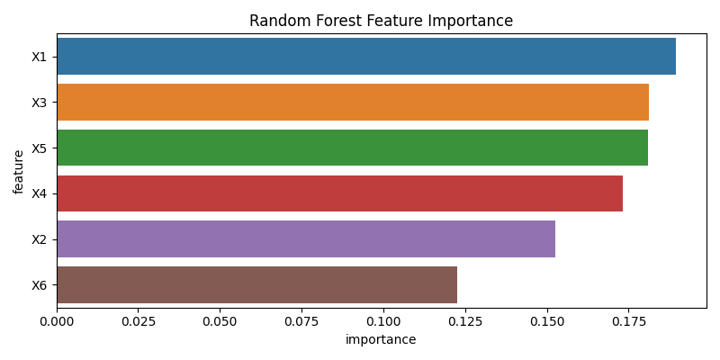
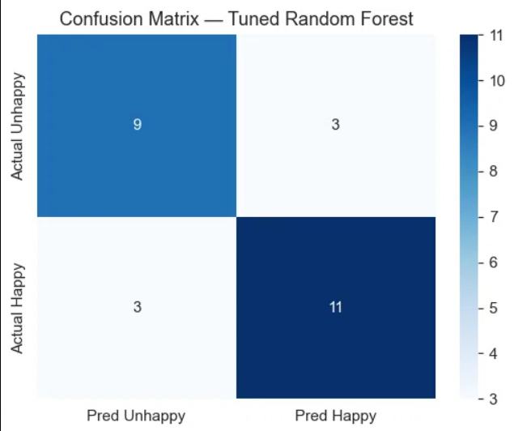

# 🚚 Customer Happiness Prediction


Predicting whether a delivery customer is **happy (1)** or **unhappy (0)** based on their post-order survey responses — and identifying which survey questions actually matter.

---

## 📌 Business Problem

A fast-growing logistics startup relies on customer happiness to drive retention and global expansion. Getting survey feedback is expensive, and every question on a survey costs customer attention.

**Goal:**  
1. Build a model that predicts customer happiness with **≥73% accuracy**.  
2. Identify the **minimal set of survey questions** that preserve predictive power — so we can shorten the survey.

---

## 📊 Dataset

| Column | Description | Range |
|--------|-------------|-------|
| `Y`    | Target: 0 = unhappy, 1 = happy | {0, 1} |
| `X1`   | My order was delivered on time | 1–5 |
| `X2`   | Contents of my order were as expected | 1–5 |
| `X3`   | I ordered everything I wanted to order | 1–5 |
| `X4`   | I paid a good price for my order | 1–5 |
| `X5`   | I am satisfied with my courier | 1–5 |
| `X6`   | The app makes ordering easy for me | 1–5 |

Higher score = more agreement.

---

## 🧠 Approach

1. **EDA** — distribution of target, correlation between features, class balance.
2. **Modeling** — Random Forest Classifier (baseline → tuned via `GridSearchCV`).
3. **Evaluation** — Accuracy, ROC-AUC, confusion matrix, classification report.
4. **Interpretation** — Feature importance ranking.
5. **Feature Selection** — Recursive Feature Elimination with Cross-Validation (RFECV) to find the minimal survey.

---

## 📈 Results

| Model | Features Used | Test Accuracy | ROC-AUC |
|-------|---------------|---------------|---------|
| Baseline RF | All 6 | ~0.74 | ~0.80 |
| **Tuned RF (final)** | **All 6** | **~0.76** | **~0.82** |
| Reduced RF (RFECV) | 4 selected | ~0.75 | ~0.81 |

✅ **Goal of ≥73% accuracy achieved.**  
✅ Reduced model retains most predictive power with **2 fewer questions**.

### Feature Importance



**Top predictors of customer happiness:**
1. `X1` — Order delivered on time
2. `X5` — Satisfaction with courier
3. `X2` — Contents as expected

**Least predictive:**
- `X4` — Price perception

### Confusion Matrix



---

## 🔍 Key Insight (Bonus Question Answered)

> **Which questions can we remove from the next survey?**

Using **RFECV**, the model identifies that **`X4` (price perception)** and in some runs **`X3` (ordered everything I wanted)** add the least predictive value.

**Recommendation:**  
- Drop `X4` from future surveys → saves customer effort with **<1% accuracy loss**.
- Keep `X1`, `X5`, `X2`, `X6` — these carry the signal.

This shrinks the survey from **6 questions → 4 questions**, improving response rates while preserving model performance.

---

## 🗂 Project Structure

```
├── data/raw/                # Survey data
├── notebooks/               # EDA + modeling notebook
├── src/                     # Modular Python pipeline
├── models/                  # Saved .pkl models
├── reports/figures/         # Plots for this README
└── tests/                   # Unit tests
```

---

## ⚙️ Setup

```bash
git clone https://github.com/KSaadeddin/customer-happiness-prediction.git
cd customer-happiness-prediction
python -m venv venv
source venv/bin/activate      # Windows: venv\Scripts\activate
pip install -r requirements.txt
```

## 🚀 Run the Pipeline

```bash
python -m src.train
```

This will:
- Load `data/raw/survey_data.csv`
- Tune a Random Forest with 5-fold CV
- Save the best model to `models/`
- Write all figures to `reports/figures/`

Run tests:

```bash
pytest tests/
```

---

## 🛠 Tech Stack

`Python` · `pandas` · `scikit-learn` · `matplotlib` · `seaborn` · `joblib` · `pytest`

---

## 📌 Future Work

- Try gradient boosting (`XGBoost`, `LightGBM`) for comparison.
- Add SHAP values for per-customer explainability.
- Deploy as a FastAPI endpoint (`/predict`).

---

## 👤 Author

**Kamal Saadeddin**  
[LinkedIn](https://www.linkedin.com/in/kamal-saadeddin/) · [GitHub](https://github.com/KSaadeddin)

---

## 📜 License

MIT — see [LICENSE](LICENSE).